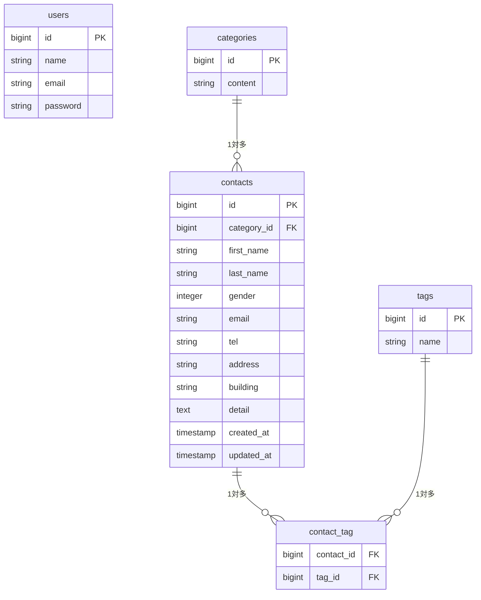

# COACHTECH お問い合わせフォーム

## 概要

Laravel 10を使用して開発したお問い合わせ管理アプリケーションです。
一般ユーザー向けのお問い合わせフォーム、管理者向けの管理画面、お問い合わせ情報を操作するREST APIを実装しました。

## 実装機能

### お問い合わせフォーム
- お問い合わせ入力画面
- 入力内容のバリデーション
- お問い合わせ確認画面
- 送信完了画面
- お問い合わせ情報の保存

### 管理者機能
- 管理者登録・ログイン・ログアウト
- お問い合わせ一覧表示
- キーワード・性別・カテゴリー・日付による検索
- お問い合わせ詳細表示・削除
- タグの登録・編集・削除
- お問い合わせデータのCSVエクスポート

### REST API
- お問い合わせ一覧取得・検索
- お問い合わせ詳細取得
- お問い合わせ新規登録
- お問い合わせ更新
- お問い合わせ削除
- ページネーション
- API ResourceによるJSONレスポンス
- 404・422エラーへの対応

## 使用技術

| 項目 | 技術 |
|---|---|
| バックエンド | PHP 8.5.8 / Laravel 10 |
| データベース | MySQL 8.4.10 |
| Webサーバー | Laravel Sail環境 |
| 認証 | Laravel Fortify |
| フロントエンド | Blade / Vite / Tailwind CSS |
| 開発環境 | Docker / Laravel Sail |
| DB管理 | phpMyAdmin |
| テスト | PHPUnit |

## ER図



お問い合わせとタグは、中間テーブル `contact_tag` を介した多対多の関係です。

管理者情報は `users` テーブルで管理します。

## 環境構築

### 前提条件

DockerとDocker Composeを利用できる環境が必要です。

### 1. リポジトリの取得

```bash
git clone <リポジトリURL>
cd <プロジェクト名>
```

### 2. Composer依存パッケージのインストール

ローカルにComposerがある場合は、以下を実行します。

```bash
composer install
```

ローカルにComposerがない場合は、Excelの環境構築手順に記載されたDocker上のComposer環境を使用してください。

### 3. 環境変数の設定

```bash
cp .env.example .env
```

`.env` のデータベース設定を以下のようにします。

```env
DB_CONNECTION=mysql
DB_HOST=mysql
DB_PORT=3306
DB_DATABASE=laravel
DB_USERNAME=sail
DB_PASSWORD=password
```

### 4. Dockerコンテナの起動

```bash
./vendor/bin/sail up -d
```

### 5. アプリケーションキーの生成

```bash
./vendor/bin/sail artisan key:generate
```

### 6. マイグレーション・初期データ投入

```bash
./vendor/bin/sail artisan migrate --seed
```

既存データを削除して初期化する場合のみ、次のコマンドを使用します。

```bash
./vendor/bin/sail artisan migrate:fresh --seed
```

### 7. フロントエンドのセットアップ

```bash
./vendor/bin/sail npm install
./vendor/bin/sail npm run dev
```

### 8. 動作確認

ブラウザで `http://localhost` にアクセスします。

## 開発環境URL

| 用途 | URL |
|---|---|
| アプリケーション | http://localhost |
| phpMyAdmin | http://localhost:8080 |
| REST API | http://localhost/api/v1/contacts |

## APIエンドポイント一覧

ベースURL：`/api/v1`

| HTTPメソッド | エンドポイント | 概要 |
|---|---|---|
| GET | `/contacts` | お問い合わせ一覧取得・検索 |
| GET | `/contacts/{contact}` | お問い合わせ詳細取得 |
| POST | `/contacts` | お問い合わせ新規登録 |
| PUT | `/contacts/{contact}` | お問い合わせ更新 |
| DELETE | `/contacts/{contact}` | お問い合わせ削除 |

### 一覧取得APIの検索パラメータ

| パラメータ | 説明 |
|---|---|
| `keyword` | 姓・名・メールアドレスを検索 |
| `gender` | 性別による絞り込み（1・2・3） |
| `category_id` | カテゴリーIDによる絞り込み |
| `date` | 登録日による絞り込み（YYYY-MM-DD） |
| `page` | ページ番号 |
| `per_page` | 1ページあたりの件数（初期値20、最大100） |

### HTTPステータスコード

| ステータス | 内容 |
|---|---|
| 200 | 取得・更新成功 |
| 201 | 新規登録成功 |
| 204 | 削除成功 |
| 404 | 指定されたお問い合わせが存在しない |
| 422 | バリデーションエラー |

APIの認証・認可は実装していません。

## テスト

Featureテストを実行する場合は、以下のコマンドを使用します。

```bash
./vendor/bin/sail artisan test --testsuite=Feature
```

## 作成者

坂田 裕樹